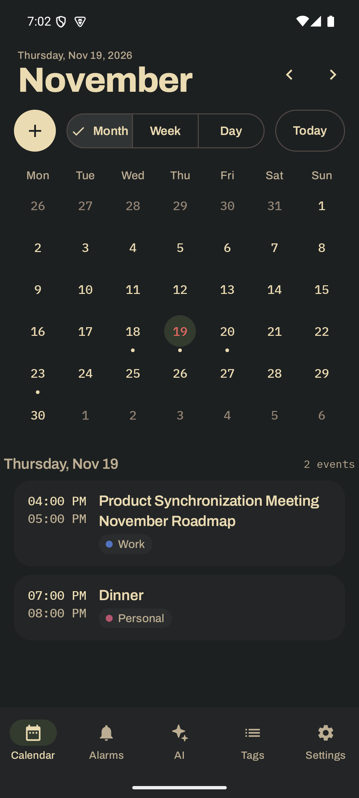
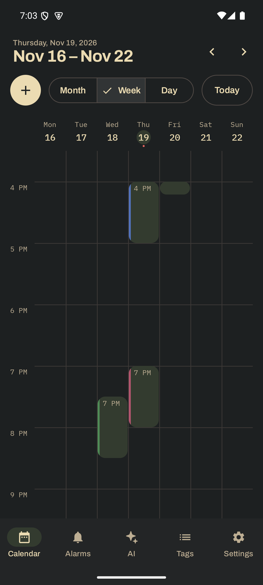
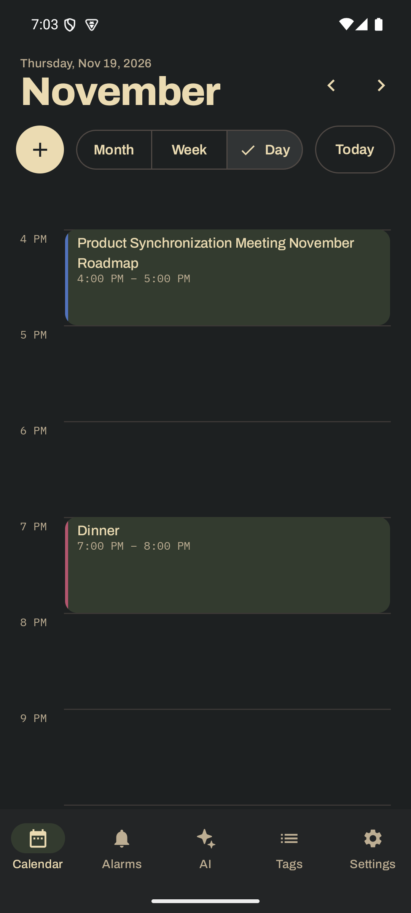
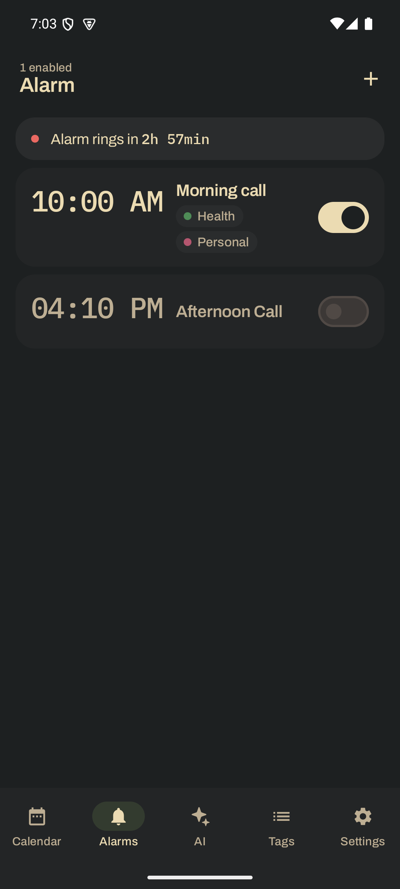
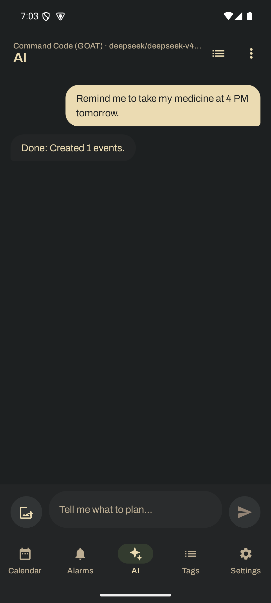
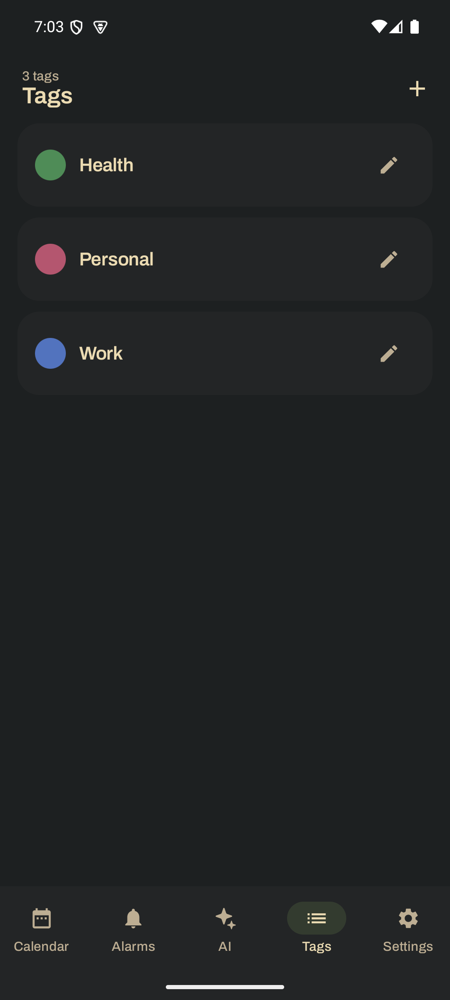
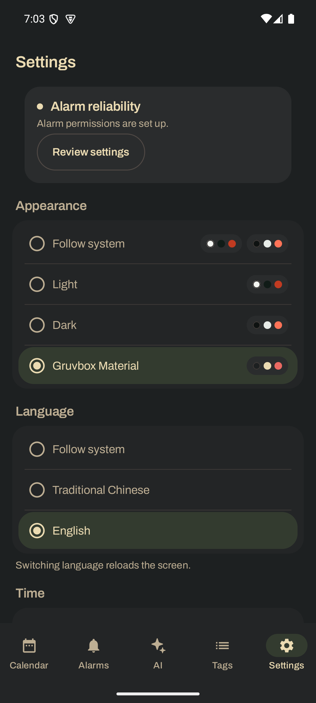
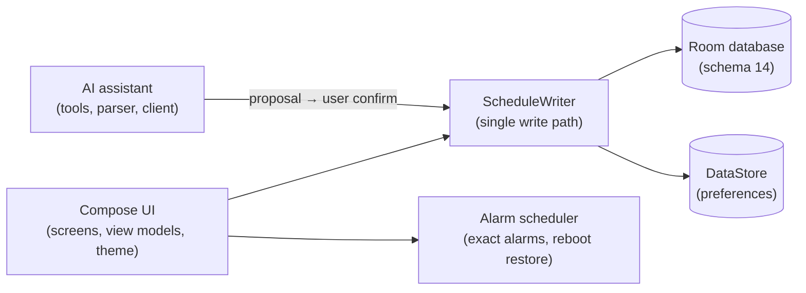

<div align="center">

<!-- TODO: add a logo at images/logo.png, then uncomment this block

-->

# Clockwise

**A local-first calendar & alarm app for Android — with an optional AI assistant.**

Jetpack Compose · Material 3 · No accounts · No tracking · Works offline

[English](README.md) · [繁體中文](README.zh-TW.md) · [简体中文](README.zh-CN.md)

[](https://github.com/DINOE-1/ClockWise-dev/actions/workflows/android.yml)
[](https://github.com/DINOE-1/ClockWise-dev/releases)
[](https://github.com/DINOE-1/ClockWise-dev/releases)
[](https://github.com/DINOE-1/ClockWise-dev/releases)
[](https://kotlinlang.org)
[](LICENSE)

</div>

Clockwise combines a month/week/day calendar, exact alarms that ring full-screen over the lock
screen, colored tags, and an optional AI assistant that can read and change your schedule — but
only after you approve a preview of every change. All data stays on the device: no account, no
analytics, no backend. The app does not depend on Google Play services.

The interface is available in English and Traditional Chinese (zh-TW) and follows the system
language by default; you can switch under **Settings → Language**.

## Table of contents

- [Screenshots](#screenshots)
- [Features](#features)
  - [Calendar](#calendar)
  - [Alarms](#alarms)
  - [AI assistant](#ai-assistant)
  - [Personalization & data](#personalization--data)
- [Screens](#screens)
- [Download](#download)
- [Requirements](#requirements)
- [Build](#build)
- [Tests](#tests)
- [AI setup](#ai-setup)
- [Privacy & security](#privacy--security)
- [Permissions](#permissions)
- [Project structure](#project-structure)
- [Contributing](#contributing)
- [Known limitations](#known-limitations)
- [License](#license)

## Screenshots

The UI is designed around a "printed timetable" identity — porcelain-paper surfaces,
Archivo for text, IBM Plex Mono for numerals, and a single vermillion accent for the current
time. The screenshots below are taken from the dark (Gruvbox Material) theme.

| Month view | Week view | Day view |
| :---: | :---: | :---: |
|  |  |  |

| Alarms | AI assistant |
| :---: | :---: |
|  |  |

| Tags | Settings |
| :---: | :---: |
|  |  |

## Features

### Calendar

- Three views — **month grid**, **week view**, and **day timeline** — with the week starting on
  Monday.
- The week view lays seven day columns on one shared hour axis, packs events like the day view
  does, and shows an all-day band; tapping a column header jumps to that day.
- Create, edit, and delete events with title, note, start/end time, all-day flag, tags, and an
  optional alarm.
- Create an event directly on the day timeline by dragging a draft block; times snap to a
  configurable interval (5–60 minutes, default 15).
- Recurring events: daily, weekly on selected weekdays, or until a chosen end date.
- Event reminders: presets of 5, 10, or 30 minutes, or any custom number of minutes up to seven
  days before the start.
- Edit or delete a single occurrence, this and all following occurrences, or the whole series.
  Series edits keep each occurrence's date and only sync shared fields.

### Alarms

- One-off alarms, alarm stacks, and alarms linked to calendar events.
- Long-press to enter selection mode and batch-delete alarms.
- Per-alarm ringtone or silent; alarms in one stack share a single ringtone, and Settings defines
  a default ringtone for alarms that do not override it.
- Exact alarms through `AlarmManager`, with a full-screen ringing screen over the lock screen;
  stop or snooze from there (snooze defaults to 10 minutes).
- Missed-alarm notification and a do-not-disturb warning.
- A reliability card checks notification, exact-alarm, full-screen-intent, and
  battery-optimization settings, with a 10-second test alarm and OEM-specific guidance for
  vivo/OriginOS.
- Enabled alarms are rescheduled after a reboot, an app update, or a system time/timezone change.

### AI assistant

- Bring your own API key for **DeepSeek** or **Command Code (GOAT)**; both use the
  OpenAI-compatible Chat Completions API.
- The assistant can list alarms and events, create/update/delete both, create recurring events,
  and attach alarms to events.
- Every write is shown as an editable preview of the affected items before anything is saved.
- Attach a photo — a timetable or an event poster — and a vision-capable model parses it into
  events.
- Conversation history keeps the three most recent chats (titles are editable); inactive chats
  expire after 24 hours.
- A usage panel reports input, output, cached, and reasoning tokens, request count, and cache
  hit rate.
- Model list discovery, manual model IDs, connection testing, and reasoning-effort selection.

### Personalization & data

- A first-run guide lets new users pick a language and theme, then swipe through a tour of each
  tab drawn live from the current theme. Skipping or finishing it is remembered.
- Language: follow system, English, or Traditional Chinese.
- Themes: follow system, light, dark, and Gruvbox Material.
- Wheel or clock time pickers, configurable timeline snap interval, and two alarm-stack
  animations.
- Colored tags shared by events and alarms, with a per-item tag limit.
- Two backup paths in **Settings → Data**: iCalendar (`.ics`) import/export for calendar events
  (recurring events keep their `RRULE`, import is additive), and a full JSON backup of events,
  alarms, and tags (import replaces everything after a destructive-action confirmation).
- All data is stored locally in Room. No account, analytics, or Clockwise backend is involved.
- Room schemas are exported to `app/schemas/` so database migrations can be reviewed and tested.

## Screens

| Tab | Purpose |
| --- | --- |
| 📅 Calendar | Month grid, week view, day timeline, event editor, recurrence scope |
| ⏰ Alarms | Alarm list, stacks, countdowns, editor, permission/reliability checks |
| 🤖 AI | Chat, change previews, image parsing, saved conversations, token usage |
| 🏷️ Tags | Create and manage colored tags |
| ⚙️ Settings | Language, theme, time picker, snap interval, alarm animation, AI config, data |

## Download

Grab an APK from [GitHub Releases](https://github.com/DINOE-1/ClockWise-dev/releases). Release
assets are named `Clockwise-<tag>.apk`:

- **Stable releases** (`vMAJOR.MINOR.PATCH`) ship a signed, R8-minified release APK.
- **Beta releases** (`vMAJOR.MINOR.PATCH-betaN`, marked as pre-release) preview upcoming changes.

The latest bleeding-edge build of every branch is also available as the `clockwise-beta`
artifact on the [Actions page](https://github.com/DINOE-1/ClockWise-dev/actions) — look for a
signed release APK attached to the most recent "Android CI" run.

## Requirements

- Android 8.0 (API 26) or newer; no Google Play services needed
- For building: JDK 17 or newer, Android SDK Platform 37, and AGP 9.4 support
  (Android Studio or a command-line SDK setup)

## Build

```bash
export JAVA_HOME=/path/to/jdk-17-or-newer
export ANDROID_HOME=/path/to/Android/Sdk

./gradlew :app:assembleDebug
```

The debug APK is written to `app/build/outputs/apk/debug/app-debug.apk`. If you prefer a
`local.properties` file, point it at your SDK instead of exporting `ANDROID_HOME`:

```properties
sdk.dir=/path/to/Android/Sdk
```

`local.properties` is intentionally git-ignored.

<details>
<summary><strong>Release build &amp; signing</strong></summary>

Release builds are minified and resource-shrunk with R8. They are signed only when all four
signing values are present; without them Gradle produces an unsigned APK so the build still
works without secrets.

```bash
export KEYSTORE_FILE=/absolute/path/to/release.keystore
export KEYSTORE_PASSWORD='...'
export KEY_ALIAS='...'
export KEY_PASSWORD='...'

./gradlew :app:assembleRelease
```

`KEYSTORE_FILE` may be absolute or relative to the repository root. The same names can be
supplied as Gradle properties instead (e.g. in `~/.gradle/gradle.properties` or via
`-PKEYSTORE_FILE=...`); the environment is used when a property is absent. A git-ignored
`keystore.properties` file at the repository root is the last fallback, so a local checkout can
stay signed without exporting variables for every build.

When signing is configured the APK is written to
`app/build/outputs/apk/release/app-release.apk`; otherwise
`app/build/outputs/apk/release/app-release-unsigned.apk`. Debug builds are signed with the same
key when one is configured, so an APK built locally can update an installed beta in place.

Never commit a keystore or its passwords (`.gitignore` excludes `*.jks`, `*.keystore`, `*.p12`,
and `keystore.properties`).

</details>

<details>
<summary><strong>Beta builds via GitHub Actions</strong></summary>

The CI workflow publishes the installable APK as the `clockwise-beta` artifact — a signed
release build, always with the same key, so a newer beta installs over an older one. The
workflow reads the `KEYSTORE_BASE64`, `KEYSTORE_PASSWORD`, `KEY_ALIAS`, and `KEY_PASSWORD`
repository secrets:

```bash
base64 -w0 release.jks   # paste the output into the KEYSTORE_BASE64 secret
```

Without those secrets the job still builds, tests, and lints, but uploads no installable APK.
Debug APKs are never published: each runner signs them with its own throwaway key, which makes
updates fail with a package conflict.

</details>

## Run

With a device or emulator connected:

```bash
adb install -r app/build/outputs/apk/debug/app-debug.apk
adb shell am start -n com.dinoe.clockwise/.MainActivity
```

## Tests

JVM unit tests cover the AI tool parser, prompt/context building, token budgeting, model
catalog, session serialization, the OpenAI-compatible client (MockWebServer), recurrence rules,
iCalendar codec, schedule writing, JSON backup, and the calendar/alarm view models:

```bash
./gradlew :app:testDebugUnitTest
```

There are no instrumentation tests in the project yet.

## AI setup

1. Open **Settings → AI assistant**.
2. Choose DeepSeek or Command Code and paste an API key.
3. Optionally refresh the model list, or enter a model ID manually.
4. Use **Test connection** to verify the key and model.
5. Return to the AI tab and start a conversation.

The assistant is optional. Without a key, the rest of the app works normally.

## Privacy & security

Clockwise is local-first. Calendar events, alarms, tags, settings, AI conversations, and usage
data are stored in a Room database and DataStore on the device. There is no Clockwise account,
analytics SDK, or backend server.

- API keys are encrypted at rest with an AES-GCM key held in the Android Keystore. The Keystore
  key is non-exportable; the plaintext key exists in memory only while a request is being made.
- When you use the assistant, the chat messages, prompts, and the schedule context needed to
  answer are sent directly to the provider you selected over HTTPS, with the key in the
  request's `Authorization` header. That data is governed by the provider's privacy policy.
  Clockwise does not proxy requests or keep a server-side copy.
- Conversations and usage data are stored only in the local Room database and are not uploaded.
- Cloud backup and device-to-device migration are disabled (`allowBackup=false`; the Android 12+
  extraction rules exclude every domain), so the database and the encrypted key blobs never
  leave the device through Android backup. Because the Keystore key is non-exportable, copied
  ciphertext could not be decrypted elsewhere anyway.
- Deleting a conversation removes it from the local database; it does not delete anything held
  by the provider. Uninstalling the app or clearing its data permanently deletes local data.
- Clockwise does not override Android's network-security policy; local HTTP endpoints remain
  subject to the platform's cleartext rules, and a LAN provider may need an HTTPS reverse proxy.

## Permissions

| Permission | Why it is used |
| --- | --- |
| `POST_NOTIFICATIONS` | Alarm ringing notifications; runtime permission on Android 13+ |
| `SCHEDULE_EXACT_ALARM` | Exact alarm scheduling on Android 12 and below |
| `USE_EXACT_ALARM` | Exact alarm scheduling on Android 13+ |
| `USE_FULL_SCREEN_INTENT` | Full-screen alarm on the lock screen |
| `RECEIVE_BOOT_COMPLETED` | Restore enabled alarms after a reboot |
| `WAKE_LOCK`, `VIBRATE` | Wake the device and vibrate while ringing |
| `FOREGROUND_SERVICE`, `FOREGROUND_SERVICE_SPECIAL_USE` | Keep the alarm ringing service alive |
| `INTERNET` | Calls to the AI provider you configure |

The app does not request location, contacts, or calendar-provider access.

## Project structure



```
app/src/main/kotlin/com/dinoe/clockwise/
├── MainActivity.kt           # Single activity host
├── ClockwiseApp.kt           # Application wiring: database, writer, repository
├── data/                     # Room entities, DAOs, recurrence, ScheduleWriter, backup, ICS
├── alarm/                    # AlarmManager scheduling, receiver, service, notifier
├── ai/                       # Providers, client, prompt, tools, parsing, key storage
└── ui/                       # Compose screens, view models, theme, pickers, design tokens
```

- **`ScheduleWriter`** is the single write path for alarms and events, used by both the UI and
  the AI assistant, keeping AI-created items consistent with manually created ones.
- **`AppDatabase`** is the Room database. Exported schemas live in `app/schemas/`; commit new
  schema files whenever the database changes.
- **`AlarmScheduler`** owns exact/inexact scheduling fallbacks and reboot rescheduling.
- **`AiTools` / `AiToolParser`** define and validate the function-calling tools. Write tools only
  produce proposals; `ScheduleWriter` runs after user confirmation.

Domain terminology is defined in [GLOSSARY.md](GLOSSARY.md).

## Contributing

Issues and pull requests are welcome — issues live in [GitHub Issues](https://github.com/DINOE-1/ClockWise-dev/issues).
Before opening a PR:

1. Keep Kotlin source, comments, and commit messages in English.
2. Run `./gradlew :app:testDebugUnitTest :app:assembleDebug`. CI also runs `lintDebug` on every
   push and pull request.
3. Add a Room schema file if you change the database.
4. Do not commit API keys, signing keys, `local.properties`, or build output.

## Known limitations

- [ ] The calendar is local-only; it does not sync with Google Calendar, CalDAV, or the system
      calendar provider
- [ ] No home-screen widget yet
- [ ] AI features depend on an external provider and its availability, pricing, and data policy

## License

Released under the [Apache License 2.0](LICENSE). The bundled typefaces —
[Archivo](https://github.com/Omnibus-Type/Archivo) and
[IBM Plex Mono](https://github.com/IBM/plex) — are licensed under the SIL Open Font License.

<div align="center">

**[⬆ Back to top](#table-of-contents)**

</div>
