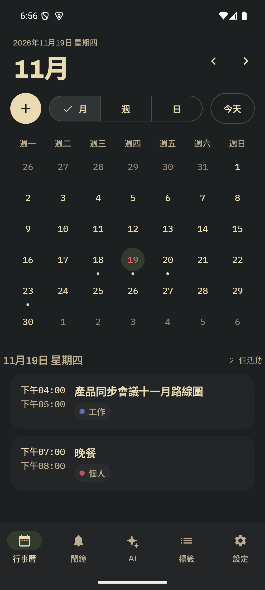
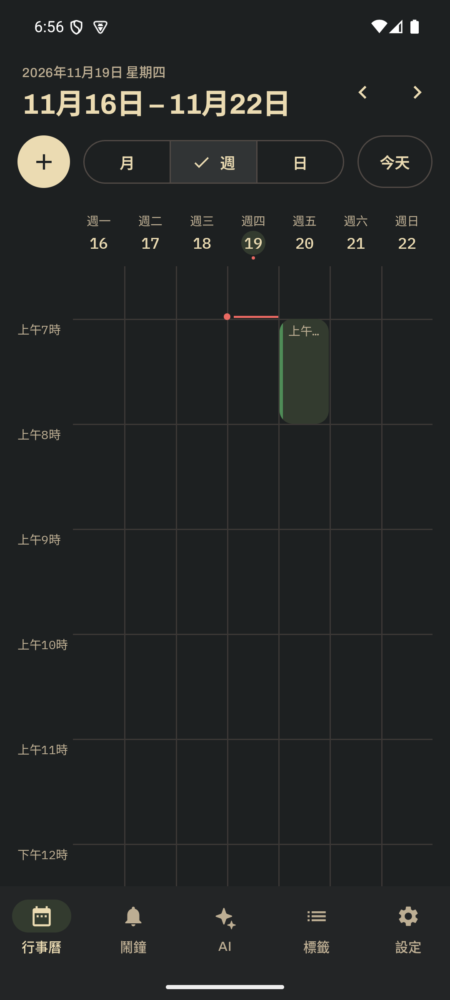
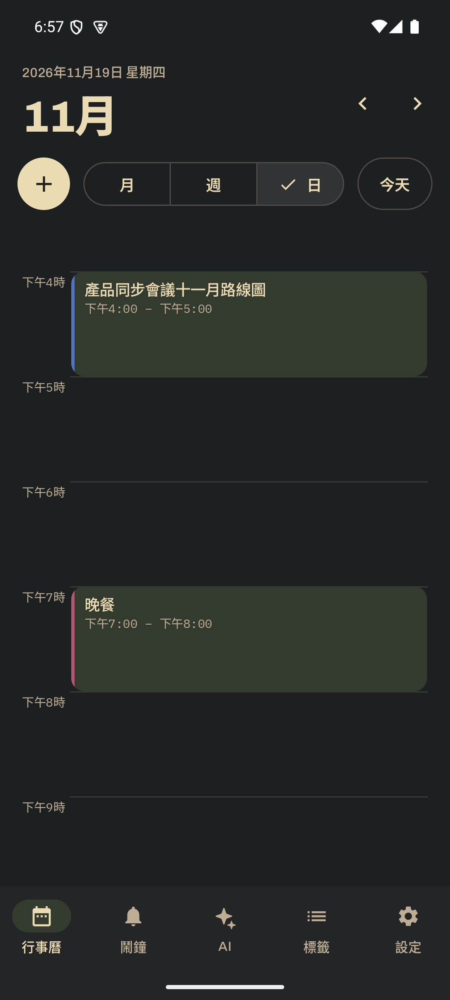
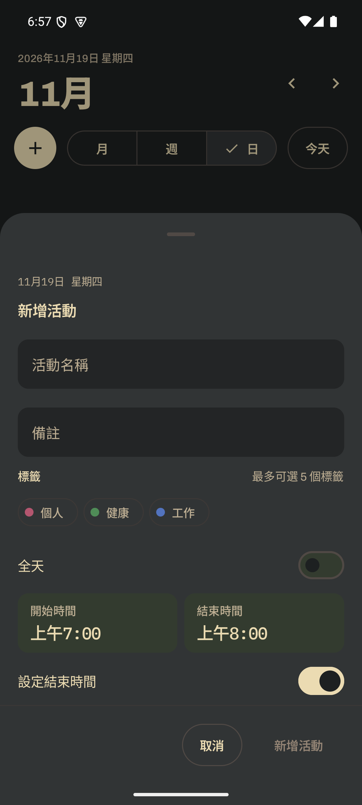
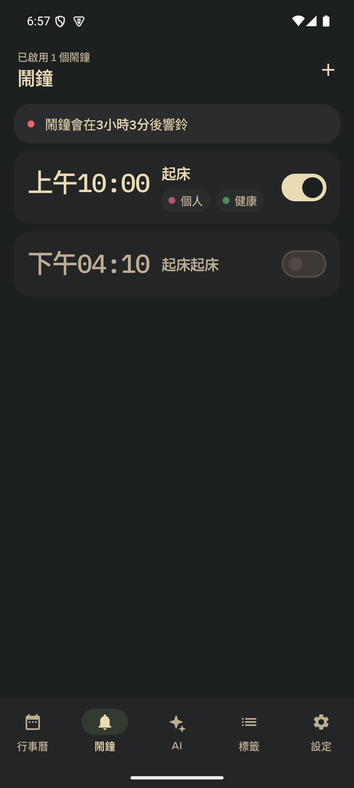
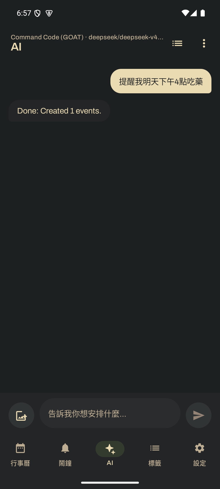
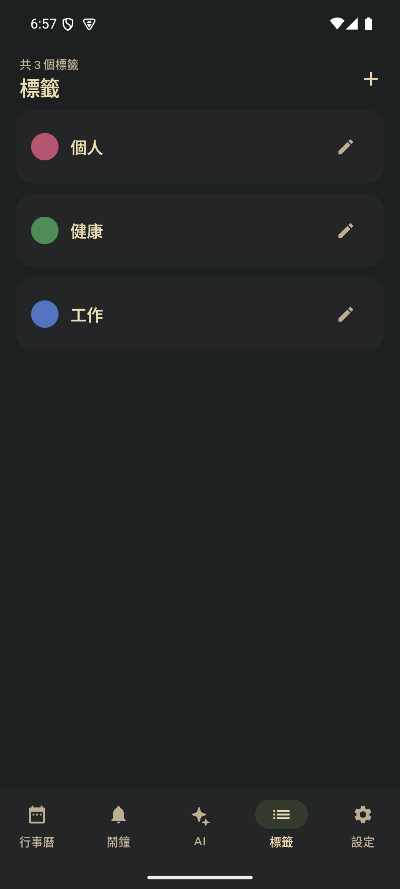
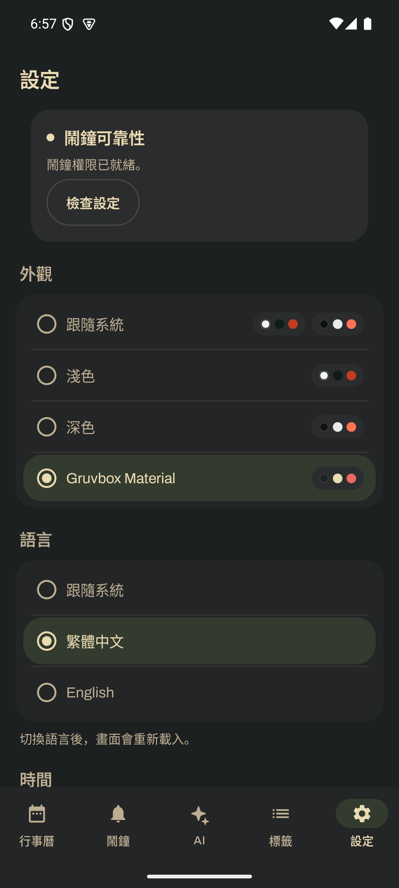
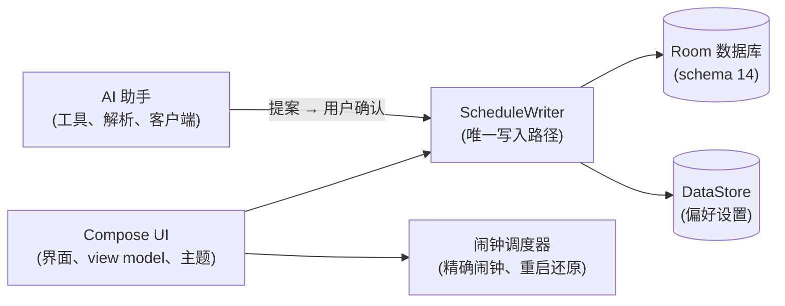

<div align="center">

<!-- TODO：在 images/logo.png 添加 logo 后取消这段注释

-->

# Clockwise

**以本地数据为优先的 Android 日历与闹钟应用 —— 附可选的 AI 助手。**

Jetpack Compose · Material 3 · 无账号 · 无追踪 · 离线可用

[English](README.md) · [繁體中文](README.zh-TW.md) · [简体中文](README.zh-CN.md)

[](https://github.com/DINOE-1/ClockWise-dev/actions/workflows/android.yml)
[](https://github.com/DINOE-1/ClockWise-dev/releases)
[](https://github.com/DINOE-1/ClockWise-dev/releases)
[](https://github.com/DINOE-1/ClockWise-dev/releases)
[](https://kotlinlang.org)
[](LICENSE)

</div>

Clockwise 结合月/周/周日历、可在锁屏上全屏响铃的精确闹钟、彩色标签，以及可选的 AI 助手
—— AI 读取并修改你的日程之前，会先显示每项变更的预览，确认后才会保存。所有数据都留在
设备上：没有账号、没有分析、没有后端。应用也不依赖 Google Play 服务。

界面提供英文与繁体中文（zh-TW），默认跟随系统语言，可在 **设置 → 语言** 切换。

## 目录

- [界面预览](#界面预览)
- [功能](#功能)
  - [日历](#日历)
  - [闹钟](#闹钟)
  - [AI 助手](#ai-助手)
  - [个性化与数据](#个性化与数据)
- [页面](#页面)
- [下载](#下载)
- [环境要求](#环境要求)
- [构建](#构建)
- [测试](#测试)
- [AI 设置](#ai-设置)
- [隐私与安全](#隐私与安全)
- [权限](#权限)
- [项目结构](#项目结构)
- [贡献](#贡献)
- [已知限制](#已知限制)
- [许可证](#许可证)

## 界面预览

UI 以"印刷时刻表"风格设计 —— 瓷白纸质观感、Archivo 负责文字、IBM Plex Mono 负责
数字，并以单一朱红色标示当前时间。以下截图取自深色（Gruvbox Material）主题。

| 月视图 | 周视图 | 日视图 |
| :---: | :---: | :---: |
|  |  |  |

| 创建活动 | 闹钟 | AI 助手 |
| :---: | :---: | :---: |
|  |  |  |

| 标签 | 设置 |
| :---: | :---: |
|  |  |

## 功能

### 日历

- **月视图网格**、**周视图**与**日时间轴**三种视图，每周从星期一开始。
- 周视图将七天纵列共用同一条小时轴，以日视图的算法排布活动，并显示全天区带；
  点按列标题即可跳转到该日的日视图。
- 创建、编辑、删除活动，包含标题、备注、开始/结束时间、全天属性、标签与可选闹钟。
- 直接在日时间轴上拖动草稿区块创建活动；时间会吸附到可配置的间隔（5–60 分钟，默认 15）。
- 重复活动：每天、每周指定星期几，或重复至指定结束日期。
- 活动提醒：可选 5、10、30 分钟预设，或自定义最多提前 7 天的提醒。
- 可只编辑或删除单个活动、此活动与所有后续活动，或整个系列。系列编辑会保留各活动的
  日期，仅同步共享字段。

### 闹钟

- 一次性闹钟、闹钟堆叠，以及关联日历活动的闹钟。
- 长按进入选择模式，可批量删除多个闹钟。
- 每个闹钟可选择铃声或设为静音；同一个堆叠共用一个铃声，设置中可指定默认铃声，
  未单独设置的闹钟会跟随默认值。
- 通过 `AlarmManager` 排定精确闹钟，并在锁屏上显示全屏响铃界面；可在该界面停止或
  贪睡（贪睡默认 10 分钟）。
- 未响闹钟通知与勿扰模式警告。
- 可靠性卡片会检查通知、精确闹钟、全屏 Intent 与电池优化设置，附带 10 秒测试闹钟与
  vivo/OriginOS 的厂商专属指引。
- 重启、应用更新或系统时间/时区变更后，会重新排定已启用的闹钟。

### AI 助手

- 自备 **DeepSeek** 或 **Command Code (GOAT)** 的 API 密钥；两者均使用与 OpenAI 兼容的
  Chat Completions API。
- 助手可列出闹钟与活动、创建/更新/删除两者、创建重复活动，并将闹钟附加到活动。
- 每次写入都会先显示受影响项目的可编辑预览；确认前不会更改任何内容。
- 可附加照片 —— 课表或活动海报 —— 由支持视觉的模型解析成活动。
- 对话记录保留最近三个对话（标题可编辑）；超过 24 小时未互动的对话会过期。
- 用量面板显示输入、输出、缓存与推理 token、请求次数，以及缓存命中率。
- 支持发现模型列表、手动输入模型 ID、测试连接与选择推理强度。

### 个性化与数据

- 首次启动的新手引导会先让用户选择语言与主题，再滑动浏览各页面的示意说明，示意图以当前
  主题实时绘制。跳过或完成后都会记住，不再显示。
- 语言：跟随系统、English 或繁体中文。
- 主题：跟随系统、浅色、深色与 Gruvbox Material。
- 滚轮或时钟时间选择器、可配置的时间轴吸附间隔，以及两种闹钟堆叠动画。
- 活动与闹钟共用彩色标签，每个项目有标签数量上限。
- **设置 → 数据** 提供两种备份方式：日历活动的 iCalendar（`.ics`）导入/导出（重复活动
  保留 `RRULE`，导入仅追加），以及活动、闹钟与标签的完整 JSON 备份（导入会在破坏性操作
  确认后替换全部数据）。
- 所有数据都存储在本地 Room 数据库。不涉及账号、分析或 Clockwise 后端。
- Room schema 会导出到 `app/schemas/`，以便审查与测试数据库迁移。

## 页面

| 页面 | 用途 |
| --- | --- |
| 📅 日历 | 月视图网格、周视图、日时间轴、活动编辑器、重复范围 |
| ⏰ 闹钟 | 闹钟列表、堆叠、倒计时、编辑器、权限/可靠性检查 |
| 🤖 AI | 对话、变更预览、图片解析、已保存对话、token 用量 |
| 🏷️ 标签 | 创建与管理彩色标签 |
| ⚙️ 设置 | 语言、主题、时间选择器、吸附间隔、闹钟动画、AI 配置、数据 |

## 下载

到 [GitHub Releases](https://github.com/DINOE-1/ClockWise-dev/releases) 下载 APK，文件
命名为 `Clockwise-<tag>.apk`：

- **稳定版**（`vMAJOR.MINOR.PATCH`）提供签名、经 R8 缩减的 release APK。
- **Beta 版**（`vMAJOR.MINOR.PATCH-betaN`，标记为 pre-release）可抢先体验即将推出的变更。

每个分支最新的前沿版本也可在 [Actions 页面](https://github.com/DINOE-1/ClockWise-dev/actions)
获取 —— 在最近一次 "Android CI" 运行结果中，找 `clockwise-beta` 产物内的签名 release APK。

## 环境要求

- Android 8.0（API 26）或更新版本；不需要 Google Play 服务
- 构建需求：JDK 17 或更新版本、Android SDK Platform 37，以及支持 AGP 9.4 的环境
  （Android Studio 或命令行 SDK）

## 构建

```bash
export JAVA_HOME=/path/to/jdk-17-or-newer
export ANDROID_HOME=/path/to/Android/Sdk

./gradlew :app:assembleDebug
```

调试 APK 会输出到 `app/build/outputs/apk/debug/app-debug.apk`。若偏好使用
`local.properties`，可将它指向 SDK，而不必导出 `ANDROID_HOME`：

```properties
sdk.dir=/path/to/Android/Sdk
```

`local.properties` 已有意加入 git 忽略。

<details>
<summary><strong>Release 构建与签名</strong></summary>

Release 构建会以 R8 缩减代码并缩减资源。只有在四项签名配置都齐全时才会签名；若缺少任一
项，Gradle 会生成未签名的 APK，让没有密钥的环境仍可完成构建。

```bash
export KEYSTORE_FILE=/absolute/path/to/release.keystore
export KEYSTORE_PASSWORD='...'
export KEY_ALIAS='...'
export KEY_PASSWORD='...'

./gradlew :app:assembleRelease
```

`KEYSTORE_FILE` 可以是绝对路径，也可以是相对于仓库根目录的路径。也可以改用同名 Gradle
属性提供（例如写在 `~/.gradle/gradle.properties`，或使用 `-PKEYSTORE_FILE=...`）；属性未
提供时会读取环境变量。仓库根目录的 `keystore.properties`（已列入 git 忽略）是最后的
备选，让本地开发不必每次构建都导出变量。

配置签名时，APK 会输出到 `app/build/outputs/apk/release/app-release.apk`；否则为
`app/build/outputs/apk/release/app-release-unsigned.apk`。配置签名后，调试版也会使用同一把
密钥，因此本地构建的 APK 可直接更新已安装的 beta。

请勿提交密钥库或其密码（`.gitignore` 已排除 `*.jks`、`*.keystore`、`*.p12` 与
`keystore.properties`）。

</details>

<details>
<summary><strong>通过 GitHub Actions 的 Beta 版</strong></summary>

CI workflow 会把可安装的 APK 发布为 `clockwise-beta` 产物 —— 它是签名过的 release 版，
而且每次运行都使用同一把密钥，所以新版 beta 可以直接覆盖旧版安装。workflow 会读取仓库
秘密 `KEYSTORE_BASE64`、`KEYSTORE_PASSWORD`、`KEY_ALIAS` 与 `KEY_PASSWORD`：

```bash
base64 -w0 release.jks   # 将输出粘贴到 KEYSTORE_BASE64 秘密
```

没有这些秘密时，任务仍会构建、测试与 lint，但不会上传可安装的 APK。调试 APK 一律不发布：
每次 runner 都会用不同的临时密钥签名，这正是更新时出现包冲突的原因。

</details>

## 运行

连接设备或模拟器后：

```bash
adb install -r app/build/outputs/apk/debug/app-debug.apk
adb shell am start -n com.dinoe.clockwise/.MainActivity
```

## 测试

JVM 单元测试涵盖 AI 工具解析器、提示/上下文构建、token 预算、模型目录、会话序列化、
与 OpenAI 兼容的客户端（MockWebServer）、重复规则、iCalendar 编解码、日程写入、JSON 备份，
以及日历/闹钟的 view model：

```bash
./gradlew :app:testDebugUnitTest
```

项目目前没有 instrumentation 测试。

## AI 设置

1. 打开 **设置 → AI 助手**。
2. 选择 DeepSeek 或 Command Code，粘贴 API 密钥。
3. 可选择刷新模型列表，或手动输入模型 ID。
4. 使用 **测试连接** 验证密钥与模型。
5. 回到 AI 页面开始对话。

AI 助手为可选功能。没有密钥时，应用的其他部分仍可正常使用。

## 隐私与安全

Clockwise 以本地数据为优先。日历活动、闹钟、标签、设置、AI 对话与用量数据都存储在设备上
的 Room 数据库与 DataStore 中。Clockwise 没有账号、分析 SDK 或后端服务器。

- API 密钥使用 Android Keystore 中的 AES-GCM 密钥加密后保存。Keystore 密钥无法导出；
  密钥明文只在发出请求时存在于内存中。
- 使用 AI 助手时，对话消息、提示，以及回答所需的日程上下文会以 HTTPS 直接发送给你选择的
  服务商，密钥会放在请求的 `Authorization` 标头。这些数据受该服务商的隐私政策约束；
  Clockwise 不会代理请求，也不会保留服务器端副本。
- 对话与用量数据只会存储在本地 Room 数据库，不会上传。
- 已禁用云备份与设备间迁移（`allowBackup=false`；Android 12+ 的数据提取规则会排除所有
  域），因此数据库与加密后的密钥内容不会通过 Android 备份离开设备。Keystore 密钥无法导出，
  即使复制了密文也无法在其他设备解密。
- 删除对话只会从本地数据库中删除，不会删除服务商保留的内容。卸载应用或清除应用数据会
  永久删除本地数据。
- Clockwise 不会覆盖 Android 的网络安全策略；本地 HTTP 端点仍受平台的明文流量规则限制，
  局域网服务可能需要 HTTPS 反向代理。

## 权限

| 权限 | 用途 |
| --- | --- |
| `POST_NOTIFICATIONS` | 闹钟响铃通知；Android 13+ 需要运行时权限 |
| `SCHEDULE_EXACT_ALARM` | Android 12 及以下的精确闹钟调度 |
| `USE_EXACT_ALARM` | Android 13+ 的精确闹钟调度 |
| `USE_FULL_SCREEN_INTENT` | 锁屏上的全屏闹钟 |
| `RECEIVE_BOOT_COMPLETED` | 重启后恢复已启用的闹钟 |
| `WAKE_LOCK`、`VIBRATE` | 响铃时唤醒设备并振动 |
| `FOREGROUND_SERVICE`、`FOREGROUND_SERVICE_SPECIAL_USE` | 让闹钟响铃服务保持运行 |
| `INTERNET` | 调用你配置的 AI 服务商 |

本应用不会请求位置、联系人权限，也不会访问系统日历提供程序。

## 项目结构



```
app/src/main/kotlin/com/dinoe/clockwise/
├── MainActivity.kt           # 单一 Activity 宿主
├── ClockwiseApp.kt           # 应用组装：数据库、writer、repository
├── data/                     # Room 实体、DAO、重复规则、ScheduleWriter、备份、ICS
├── alarm/                    # AlarmManager 调度、receiver、service、notifier
├── ai/                       # 服务商、客户端、提示、工具、密钥存储
└── ui/                       # Compose 界面、view model、主题、选择器、设计 token
```

- **`ScheduleWriter`** 是闹钟与活动的唯一写入路径，供 UI 与 AI 助手共用，确保 AI 创建的
  项目与手动创建的一致。
- **`AppDatabase`** 是 Room 数据库。导出的 schema 位于 `app/schemas/`；数据库变更时请一并
  提交新的 schema 文件。
- **`AlarmScheduler`** 负责精确/非精确调度的回退与重启后的重新调度。
- **`AiTools` / `AiToolParser`** 定义并验证 function-calling 工具。写入工具只会生成提案；
  用户确认后才由 `ScheduleWriter` 执行。

领域术语定义于 [GLOSSARY.md](GLOSSARY.md)。

## 贡献

欢迎提交 issue 与 pull request —— issue 位于 [GitHub Issues](https://github.com/DINOE-1/ClockWise-dev/issues)。
打开 PR 之前：

1. Kotlin 源代码、注释与 commit 信息请保持英文。
2. 运行 `./gradlew :app:testDebugUnitTest :app:assembleDebug`。CI 也会在每次 push 与 pull
   request 时运行 `lintDebug`。
3. 如果修改数据库，请添加 Room schema 文件。
4. 请勿提交 API 密钥、签名密钥、`local.properties` 或构建产物。

## 已知限制

- [ ] 日历仅限本地；不会与 Google 日历、CalDAV 或系统日历提供程序同步
- [ ] 尚无主屏幕小部件
- [ ] AI 功能依赖外部服务商及其可用性、价格与数据政策

## 许可证

以 [Apache License 2.0](LICENSE) 授权。内置字体 —— [Archivo](https://github.com/Omnibus-Type/Archivo)
与 [IBM Plex Mono](https://github.com/IBM/plex) —— 采用 SIL Open Font License 授权。

<div align="center">

**[⬆ 返回目录](#目录)**

</div>
