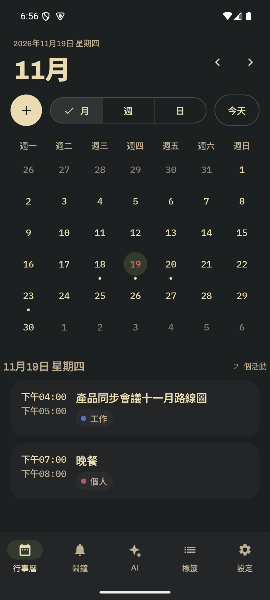
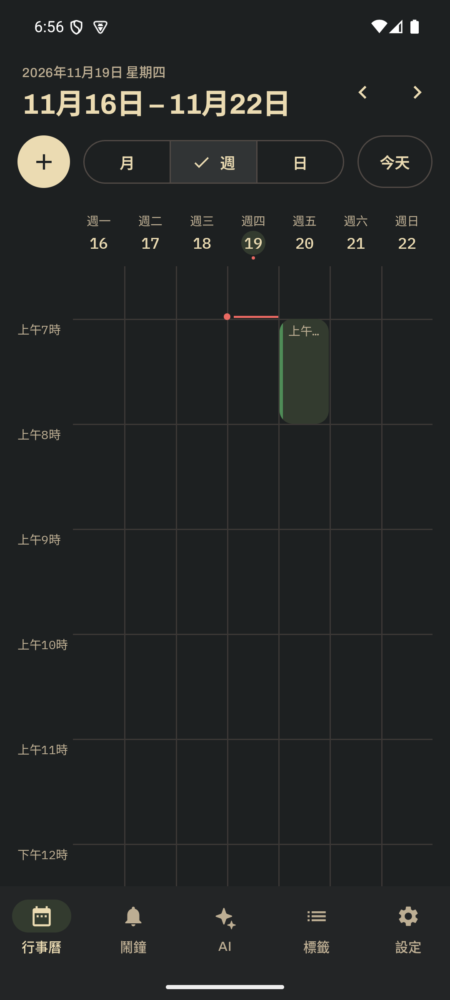
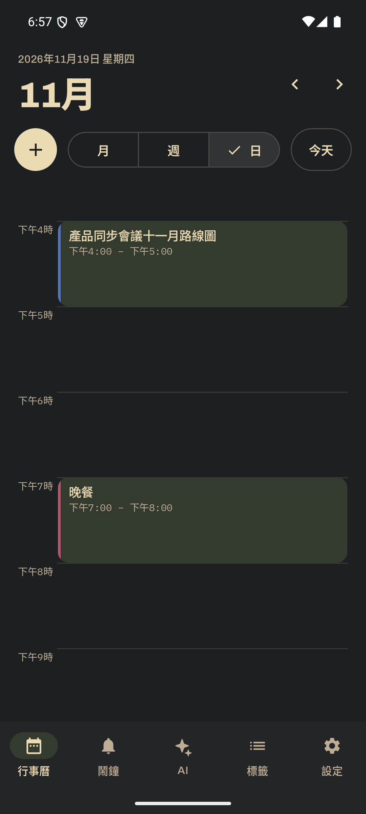
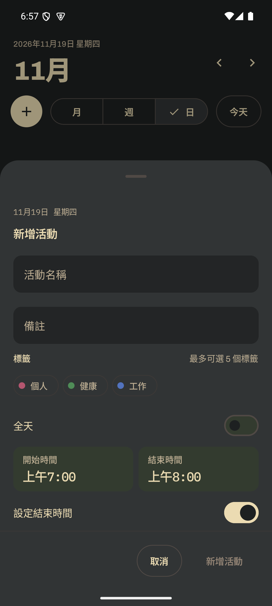
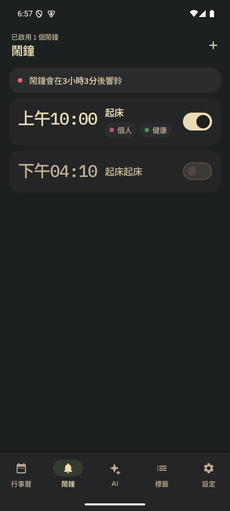
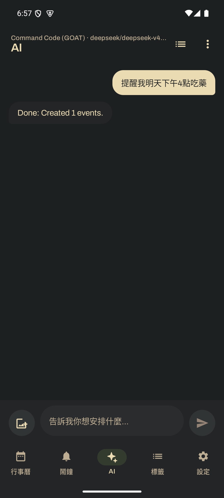
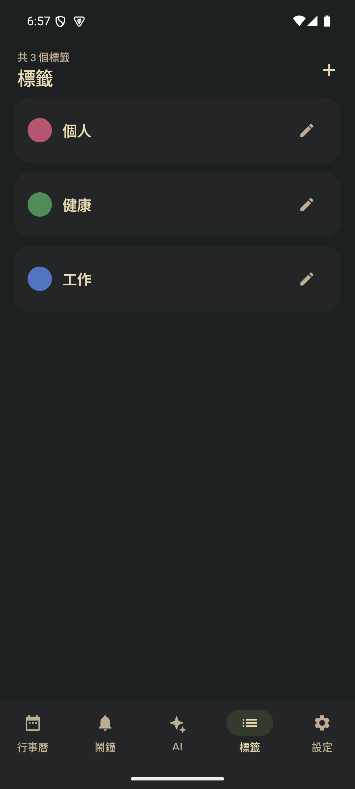
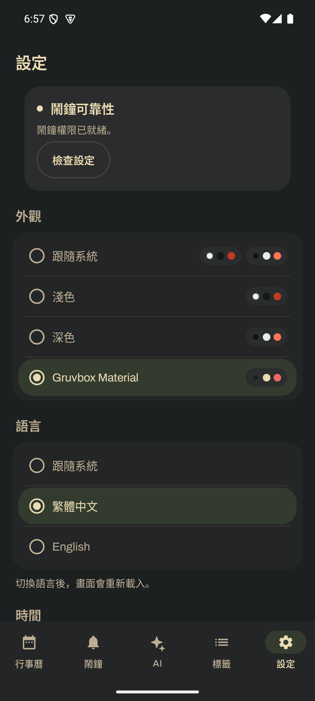
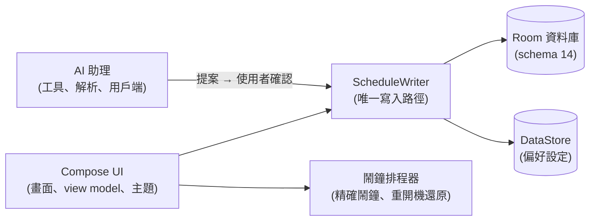

<div align="center">

<!-- TODO：加入 logo 至 images/logo.png 後解開這段註解

-->

# Clockwise

**以本機資料為優先的 Android 行事曆與鬧鐘應用程式 —— 附可選的 AI 助理。**

Jetpack Compose · Material 3 · 無帳號 · 無追蹤 · 離線可用

[English](README.md) · [繁體中文](README.zh-TW.md) · [简体中文](README.zh-CN.md)

[](https://github.com/DINOE-1/ClockWise/actions/workflows/android.yml)
[](https://github.com/DINOE-1/ClockWise/releases)
[](https://github.com/DINOE-1/ClockWise/releases)
[](https://github.com/DINOE-1/ClockWise/releases)
[](https://kotlinlang.org)
[](LICENSE)

</div>

Clockwise 結合月/週/日行事曆、可在鎖定畫面上全螢幕響鈴的精確鬧鐘、彩色標籤，以及可選的
AI 助理 —— AI 讀取並修改你的行程前，會先顯示每項變更的預覽，確認後才會儲存。所有資料都
留在裝置上：沒有帳號、沒有分析、沒有後端。應用程式也不依賴 Google Play 服務。

介面提供英文與繁體中文（zh-TW），預設跟隨系統語言，可在 **設定 → 語言** 切換。

## 目錄

- [畫面預覽](#畫面預覽)
- [功能](#功能)
  - [行事曆](#行事曆)
  - [鬧鐘](#鬧鐘)
  - [AI 助理](#ai-助理)
  - [個人化與資料](#個人化與資料)
- [頁籤](#頁籤)
- [下載](#下載)
- [環境需求](#環境需求)
- [建置](#建置)
- [測試](#測試)
- [AI 設定](#ai-設定)
- [隱私與安全性](#隱私與安全性)
- [權限](#權限)
- [專案結構](#專案結構)
- [貢獻](#貢獻)
- [已知限制](#已知限制)
- [授權條款](#授權條款)

## 畫面預覽

UI 以「印刷時刻表」風格設計 —— 瓷白紙面質感、Archivo 負責文字、IBM Plex Mono
負責數字，並以單一硃紅色標示目前時間。以下截圖取自深色（Gruvbox Material）主題。

| 月檢視 | 週檢視 | 日檢視 |
| :---: | :---: | :---: |
|  |  |  |

| 建立活動 | 鬧鐘 | AI 助理 |
| :---: | :---: | :---: |
|  |  |  |

| 標籤 | 設定 |
| :---: | :---: |
|  |  |

## 功能

### 行事曆

- **月曆格線**、**週檢視**與**日時間軸**三種檢視，每週從星期一開始。
- 週檢視將七天直欄共用同一條小時軸，以日檢視的演算法排版活動，並顯示全天區帶；
  點選欄位標題即可跳到該日的日檢視。
- 建立、編輯、刪除活動，包含標題、備註、開始/結束時間、全天屬性、標籤與可選鬧鐘。
- 直接在日時間軸上拖曳草稿區塊建立活動；時間會吸附到可設定的間隔（5–60 分鐘，預設 15）。
- 重複活動：每天、每週指定星期幾，或重複至指定結束日期。
- 活動提醒：可選 5、10、30 分鐘預設，或自訂最多提前 7 天的提醒。
- 可只編輯或刪除單一活動、此活動與所有後續活動，或整個系列。系列編輯會保留各活動日期，
  只同步共用欄位。

### 鬧鐘

- 一次性鬧鐘、鬧鐘堆疊，以及連結行事曆活動的鬧鐘。
- 長按進入選取模式，可批次刪除多個鬧鐘。
- 每個鬧鐘可選擇鈴聲或設為靜音；同一個堆疊共用一個鈴聲，設定中可指定預設鈴聲，
  未另行設定的鬧鐘會跟隨預設。
- 透過 `AlarmManager` 排定精確鬧鐘，並在鎖定畫面上顯示全螢幕響鈴畫面；可在該畫面停止或
  貪睡（貪睡預設 10 分鐘）。
- 未響鬧鐘通知與勿擾模式警告。
- 可靠性卡片會檢查通知、精確鬧鐘、全螢幕意圖與電池最佳化設定，附 10 秒測試鬧鐘與
  vivo/OriginOS 的 OEM 專屬指引。
- 重新開機、應用程式更新或系統時間/時區變更後，會重新排定已啟用的鬧鐘。

### AI 助理

- 自備 **DeepSeek** 或 **Command Code (GOAT)** 的 API 金鑰；兩者皆使用與 OpenAI 相容的
  Chat Completions API。
- 助理可列出鬧鐘與活動、建立/更新/刪除兩者、建立重複活動，並將鬧鐘附加到活動。
- 每次寫入都會先顯示受影響項目的可編輯預覽；確認前不會變更任何內容。
- 可附加照片 —— 課表或活動海報 —— 由支援視覺的模型解析成活動。
- 對話記錄保留最近三個對話（標題可編輯）；超過 24 小時未互動的對話會過期。
- 用量面板顯示輸入、輸出、快取與推理 token、請求次數，以及快取命中率。
- 支援探索模型清單、手動輸入模型 ID、測試連線與選擇推理強度。

### 個人化與資料

- 首次啟動的新手引導會先讓使用者選擇語言與主題，再滑動瀏覽各頁籤的示意說明，示意圖以
  目前主題即時繪製。略過或完成後都會記住，不再顯示。
- 語言：跟隨系統、English 或繁體中文。
- 主題：跟隨系統、淺色、深色與 Gruvbox Material。
- 滾輪或時鐘時間選擇器、可設定的時間軸吸附間隔，以及兩種鬧鐘堆疊動畫。
- 活動與鬧鐘共用彩色標籤，每個項目有標籤數量上限。
- **設定 → 資料** 提供兩種備份方式：行事曆活動的 iCalendar（`.ics`）匯入/匯出（重複活動
  保留 `RRULE`，匯入僅附加），以及活動、鬧鐘與標籤的完整 JSON 備份（匯入會在破壞性操作
  確認後取代全部資料）。
- 所有資料都存放在本機 Room DB。不涉及帳號、分析或 Clockwise 後端。
- Room schema 會匯出到 `app/schemas/`，以便檢閱與測試資料庫遷移。

## 頁籤

| 頁籤 | 用途 |
| --- | --- |
| 📅 行事曆 | 月曆格線、週檢視、日時間軸、活動編輯器、重複範圍 |
| ⏰ 鬧鐘 | 鬧鐘清單、堆疊、倒數、編輯器、權限/可靠性檢查 |
| 🤖 AI | 對話、變更預覽、圖片解析、已儲存對話、token 用量 |
| 🏷️ 標籤 | 建立與管理彩色標籤 |
| ⚙️ 設定 | 語言、主題、時間選擇器、吸附間隔、鬧鐘動畫、AI 設定、資料 |

## 下載

到 [GitHub Releases](https://github.com/DINOE-1/ClockWise/releases) 下載 APK，檔案
命名為 `Clockwise-<tag>.apk`：

- **穩定版**（`vMAJOR.MINOR.PATCH`）提供簽章過、經 R8 縮減的 release APK。
- **Beta 版**（`vMAJOR.MINOR.PATCH-betaN`，標記為 pre-release）可搶先體驗即將推出的變更。

每個分支最新的前緣版本也可在 [Actions 頁面](https://github.com/DINOE-1/ClockWise/actions)
取得 —— 在最近一次「Android CI」執行結果中，找 `clockwise-beta` 產物內的簽章 release APK。

## 環境需求

- Android 8.0（API 26）或更新版本；不需要 Google Play 服務
- 建置需求：JDK 17 或更新版本、Android SDK Platform 37，以及支援 AGP 9.4 的環境
  （Android Studio 或命令列 SDK）

## 建置

```bash
export JAVA_HOME=/path/to/jdk-17-or-newer
export ANDROID_HOME=/path/to/Android/Sdk

./gradlew :app:assembleDebug
```

偵錯 APK 會輸出到 `app/build/outputs/apk/debug/app-debug.apk`。若偏好使用
`local.properties`，可將它指向 SDK，而不必匯出 `ANDROID_HOME`：

```properties
sdk.dir=/path/to/Android/Sdk
```

`local.properties` 已刻意列入 git 忽略。

<details>
<summary><strong>Release 建置與簽章</strong></summary>

Release 建置會以 R8 縮減程式碼並縮減資源。只有在四項簽章設定都齊全時才會簽章；若缺少
任一項，Gradle 會產生未簽章的 APK，讓沒有金鑰的環境仍可完成建置。

```bash
export KEYSTORE_FILE=/absolute/path/to/release.keystore
export KEYSTORE_PASSWORD='...'
export KEY_ALIAS='...'
export KEY_PASSWORD='...'

./gradlew :app:assembleRelease
```

`KEYSTORE_FILE` 可以是絕對路徑，也可以是相對於儲存庫根目錄的路徑。也可以改用同名 Gradle
屬性提供（例如寫在 `~/.gradle/gradle.properties`，或使用 `-PKEYSTORE_FILE=...`）；屬性未
提供時會讀取環境變數。儲存庫根目錄的 `keystore.properties`（已列入 git 忽略）是最後的
備援，讓本機開發不必每次建置都匯出變數。

有設定簽章時，APK 會輸出到 `app/build/outputs/apk/release/app-release.apk`；否則為
`app/build/outputs/apk/release/app-release-unsigned.apk`。設定簽章後，偵錯版也會使用同一把
金鑰，因此本機建置的 APK 可直接更新已安裝的 beta。

請勿提交金鑰庫或其密碼（`.gitignore` 已排除 `*.jks`、`*.keystore`、`*.p12` 與
`keystore.properties`）。

</details>

<details>
<summary><strong>透過 GitHub Actions 的 Beta 版</strong></summary>

CI workflow 會把可安裝的 APK 發佈成 `clockwise-beta` 產物 —— 它是簽章過的 release 版，
而且每次執行都使用同一把金鑰，所以新版 beta 可以直接覆蓋舊版安裝。workflow 會讀取儲存庫
秘密 `KEYSTORE_BASE64`、`KEYSTORE_PASSWORD`、`KEY_ALIAS` 與 `KEY_PASSWORD`：

```bash
base64 -w0 release.jks   # 將輸出貼到 KEYSTORE_BASE64 秘密
```

沒有這些秘密時，工作仍會建置、測試與 lint，但不會上傳可安裝的 APK。偵錯 APK 一律不發佈：
每次 runner 都會用不同的臨時金鑰簽章，這正是更新時出現套件衝突的原因。

</details>

## 執行

連接裝置或模擬器後：

```bash
adb install -r app/build/outputs/apk/debug/app-debug.apk
adb shell am start -n com.dinoe.clockwise/.MainActivity
```

## 測試

JVM 單元測試涵蓋 AI 工具解析器、提示/上下文建構、token 預算、模型目錄、工作階段序列化、
與 OpenAI 相容的用戶端（MockWebServer）、重複規則、iCalendar 編解碼、行程寫入、JSON 備份，
以及行事曆/鬧鐘的 view model：

```bash
./gradlew :app:testDebugUnitTest
```

專案目前沒有 instrumentation 測試。

## AI 設定

1. 開啟 **設定 → AI 助理**。
2. 選擇 DeepSeek 或 Command Code，貼上 API 金鑰。
3. 可選擇重新整理模型清單，或手動輸入模型 ID。
4. 使用 **測試連線** 驗證金鑰與模型。
5. 回到 AI 頁籤開始對話。

AI 助理為選用功能。沒有金鑰時，應用程式其他部分仍可正常運作。

## 隱私與安全性

Clockwise 以本機資料為優先。行事曆活動、鬧鐘、標籤、設定、AI 對話與用量資料都存放在裝置上
的 Room 資料庫與 DataStore。Clockwise 沒有帳號、分析 SDK 或後端伺服器。

- API 金鑰會以 Android Keystore 中的 AES-GCM 金鑰加密後存放。Keystore 金鑰無法匯出；
  金鑰明文只在發出請求時存在於記憶體中。
- 使用 AI 助理時，對話訊息、提示，以及回答所需的行程內容會以 HTTPS 直接傳送給你選擇的
  服務商，金鑰會放在請求的 `Authorization` 標頭。這些資料受該服務商的隱私政策規範；
  Clockwise 不會代理請求，也不會保留伺服器端副本。
- 對話與用量資料只會存放在本機 Room 資料庫，不會上傳。
- 已停用雲端備份與裝置間移轉（`allowBackup=false`；Android 12+ 的資料擷取規則會排除所有
  網域），因此資料庫與加密後的金鑰內容不會透過 Android 備份離開裝置。Keystore 金鑰無法
  匯出，即使複製了密文也無法在其他裝置解密。
- 刪除對話只會從本機資料庫移除，不會刪除服務商保留的內容。解除安裝應用程式或清除應用程式
  資料會永久刪除本機資料。
- Clockwise 不會覆寫 Android 的網路安全政策；本機 HTTP 端點仍受平台的明文連線規則限制，
  區域網路服務可能需要 HTTPS 反向代理。

## 權限

| 權限 | 用途 |
| --- | --- |
| `POST_NOTIFICATIONS` | 鬧鐘響鈴通知；Android 13+ 需執行階段權限 |
| `SCHEDULE_EXACT_ALARM` | Android 12 以下的精確鬧鐘排程 |
| `USE_EXACT_ALARM` | Android 13+ 的精確鬧鐘排程 |
| `USE_FULL_SCREEN_INTENT` | 鎖定畫面上的全螢幕鬧鐘 |
| `RECEIVE_BOOT_COMPLETED` | 重新開機後還原已啟用的鬧鐘 |
| `WAKE_LOCK`、`VIBRATE` | 響鈴時喚醒裝置並震動 |
| `FOREGROUND_SERVICE`、`FOREGROUND_SERVICE_SPECIAL_USE` | 讓鬧鐘響鈴服務保持運作 |
| `INTERNET` | 呼叫你設定的 AI 服務商 |

本應用程式不會要求位置、聯絡人權限，也不會存取系統行事曆提供者。

## 專案結構



```
app/src/main/kotlin/com/dinoe/clockwise/
├── MainActivity.kt           # 單一 Activity 宿主
├── ClockwiseApp.kt           # 應用程式組裝：資料庫、writer、repository
├── data/                     # Room 實體、DAO、重複規則、ScheduleWriter、備份、ICS
├── alarm/                    # AlarmManager 排程、receiver、service、notifier
├── ai/                       # 服務商、用戶端、提示、工具、金鑰儲存
└── ui/                       # Compose 畫面、view model、主題、選擇器、設計 token
```

- **`ScheduleWriter`** 是鬧鐘與活動的唯一寫入路徑，供 UI 與 AI 助理共用，確保 AI 建立的
  項目與手動建立的一致。
- **`AppDatabase`** 是 Room 資料庫。匯出的 schema 位於 `app/schemas/`；資料庫變更時請一併
  提交新的 schema 檔案。
- **`AlarmScheduler`** 負責精確/非精確排程的備援與重新開機後的重排。
- **`AiTools` / `AiToolParser`** 定義並驗證 function-calling 工具。寫入工具只會產生提案；
  使用者確認後才由 `ScheduleWriter` 執行。

領域術語定義於 [GLOSSARY.md](GLOSSARY.md)。

## 貢獻

歡迎提出 issue 與 pull request —— issue 位於 [GitHub Issues](https://github.com/DINOE-1/ClockWise/issues)。
開啟 PR 前：

1. Kotlin 原始碼、註解與 commit 訊息請保持英文。
2. 執行 `./gradlew :app:testDebugUnitTest :app:assembleDebug`。CI 也會在每次 push 與 pull
   request 時執行 `lintDebug`。
3. 若變更資料庫，請新增 Room schema 檔案。
4. 請勿提交 API 金鑰、簽章金鑰、`local.properties` 或建置產物。

## 已知限制

- [ ] 行事曆僅限本機；不會與 Google 行事曆、CalDAV 或系統行事曆提供者同步
- [ ] 尚無主畫面小工具
- [ ] AI 功能依賴外部服務商及其可用性、價格與資料政策

## 授權條款

以 [Apache License 2.0](LICENSE) 授權。內嵌字型 —— [Archivo](https://github.com/Omnibus-Type/Archivo)
與 [IBM Plex Mono](https://github.com/IBM/plex) —— 採用 SIL Open Font License 授權。

<div align="center">

**[⬆ 回到頂端](#目錄)**

</div>
